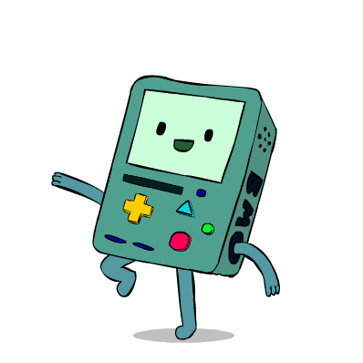

# Hanson

Python ile yazılmış, Türkçe konuşan bir masaüstü sesli asistan. Sesle Google, YouTube ve Wikipedia araması yapıyor; QR kod okuyor, not tutuyor ve içinde iki mini oyun var.

## Neden?

Günlük işlerin bir kısmını, örneğin bir şey aratmayı, video açmayı, QR kod okutmayı ya da not almayı tek bir uygulamadan ve sesle yapabilmek için yapıldı. Üniversitede Ocak 2022'de iki kişilik bir ekip projesi olarak hazırlandı.

## Neler yapıyor

- **Sesli konuşma:** Başlat'a basınca Hanson dinlemeye başlıyor. Önce gelen sesin yüksekliğini ölçüp ekranda gösteriyor, sonra söyleneni yazıya çeviriyor ve karşılık gelen komutu arıyor. Anlamazsa anlamadığını söyleyip yeniden dinliyor. Cevapları Türkçe sesle veriyor.
- **Arama:** "Google", "YouTube", "Wikipedia" denince ne aratılacağını sorup sonucu açıyor. Bir yerin konumunu haritada gösterebiliyor.
- **Sohbet:** şiir, fıkra, tekerleme okuyor, şarkı söylüyor, şaka yapıyor.
- **QR kod:** kameradan ya da ekranda seçilen bir alandan QR kod okuyup ilgili sayfayı açıyor.
- **YouTube ekranı:** video arayıp açıyor ve 720p indirebiliyor.
- **Notlar:** birden çok not sayfası açılıp kaydedilebiliyor.
- **Mini oyunlar:** PyGame ile yazılmış "Füzeden Kaçış" ve "Shrek'ten Kaçış".
- Açılışta dolan bir yükleme ekranı var.

## Teknik

| | |
|---|---|
| **Dil** | Python |
| **Arayüz** | PyQt5 |
| **Ses** | SpeechRecognition (sesten yazıya), pyttsx3 (yazıdan sese), sounddevice (ses yüksekliği) |
| **Diğer** | OpenCV ve pyzbar (QR), pytube (YouTube indirme), PyQtWebEngine (YouTube ekranı), PyGame (oyunlar), Wikipedia, threading |

| Dosya | İçerik |
|---|---|
| `AnaDosya.py` | Başlangıç: yükleme ekranı ve ana pencere |
| `Hanson.py` | Ana pencere ve menüler |
| `hanson_konus_ekran.py` | Sesli asistan ekranı |
| `QR_kamera.py`, `Qr_kamera_ekran.py` | QR kod okuma |
| `youtube_Ekran.py`, `notlar_icin.py` | YouTube ve not ekranları |
| `PyGame/`, `Shrek/` | Mini oyunlar |
| `tolga.reg` | Windows'taki Türkçe "Tolga" sesini pyttsx3'ün kullanabilmesi için kayıt dosyası |

## Çalıştırma

1. Gerekli paketler kuruluyor: `PyQt5`, `PyQtWebEngine`, `SpeechRecognition`, `pyttsx3`, `sounddevice`, `numpy`, `opencv-python`, `pyzbar`, `pyscreenshot`, `pytube`, `pygame`, `wikipedia`, `pyautogui`.
2. Türkçe ses için `tolga.reg` dosyası çift tıklanarak kayıt defterine ekleniyor.
3. `python AnaDosya.py`
